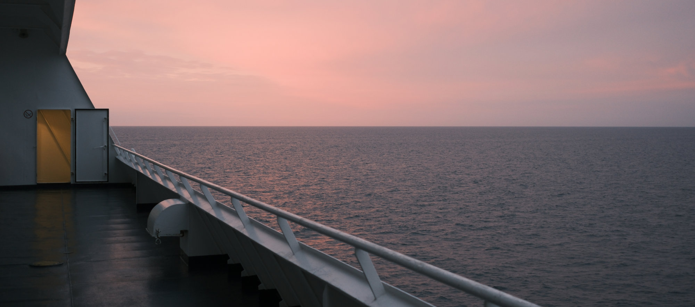

{fig-alt="A photo of the sunset from the bow observation deck of a ferry. A door is open with a soft light emanating."}

Welcome to the blog section of Mike's website.
Here you can find news, methods, exploration, data ideas, talks, projects and more.

You can follow this blog using the [RSS feed](blog.xml) 

Blog's are not written overnight, so while I build a library of posts please have a look at my old academic blog [Scottish Snow](https://scottishsnow.wordpress.com).
