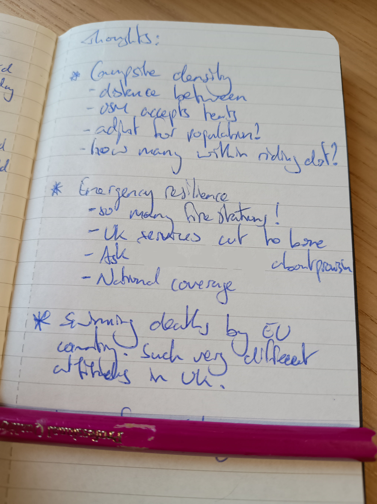

<iframe title="Pixelfed Post Embed" src="https://pixelfed.scot/p/mikerspencer/985620994870045308/embed?caption=true&likes=false&layout=full" class="pixelfed__embed" style="max-width: 100%; border: 0" width="400" allowfullscreen="allowfullscreen"></iframe>

I spoke at Edinburgh's [TravelTech meetup](https://luma.com/bv0zq4gg?tk=eiWFAk) last night.
It's a friendly event organised by [Joshua Ryan-Saha](https://www.linkedin.com/in/joshuaryansaha/) and [Maddy Burgoyne](https://www.linkedin.com/in/maddy-burgoyne-4061911a3/).

My talk was on using [OpenStreetMap](https://www.openstreetmap.org/) data, despite the session topic no AI was involved.
I think it was appropriate as I included tips on accessing OSM data in a sustainable way and structured data is very much *AI ready*.

You can view my slides on Zenodo: [10.5281/zenodo.24531364](https://doi.org/10.5281/zenodo.24531364)

I spoke about some of the ways I've used OSM data in the past, along with a challenge to the community about Le Tour De France preparedness!
Joshua asked a great question on what am I currently working on.
I took a sabbatical in the summer and cycled to Denmark with my family.
It was a great opporunity to compare communities between home and the three countries we cycled through.
Unsurpringly, I had lots of thoughts about accommodation and resilience!
Here's my notebook page, hopefully I'll get to look at some of these in 2027:

{fig-alt="Notebook page with: campsite density, distance, osm tent category, population adjustment, riding distance. Emergency resilience, many fire stations, UK services cut. Swimming deaths by country..." width=500 fig-align="center"}
