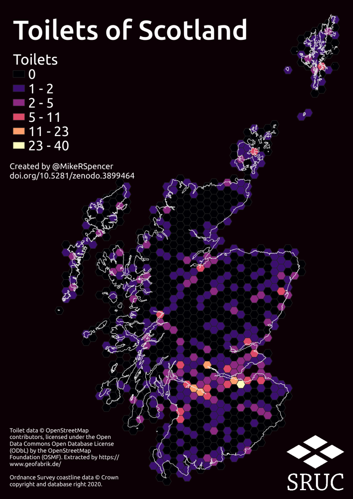
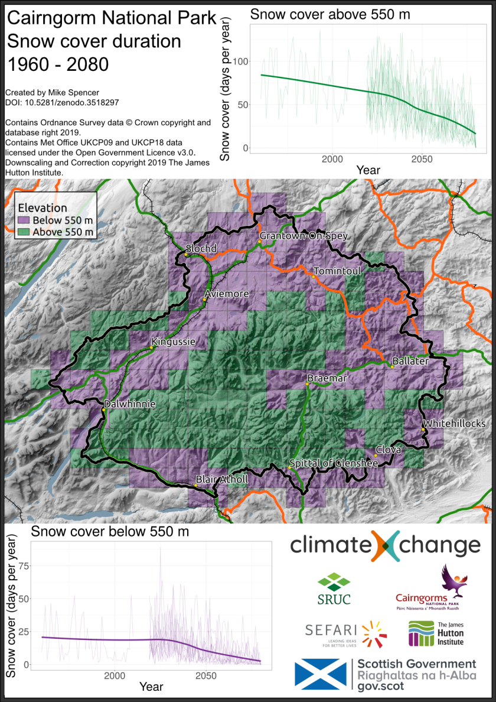

{fig-alt="Logo with the website address and a tagline of human insight for your data needs."}

Navigating the data landscape is hard.
We'd all love to achieve our lofty goals, but the distance to them from our reality seems larger than ever. I help people and organisations bridge the gap between their starting points and goals.

What I bring is the experience to chart a course to an effective solution, and helping you get there in an efficient way.

---

## Services

Pick a time that suits you to talk through the challenge you'd like to solve.
For more information see [my services](services.qmd) page.

:::: { .center}

::: {.button}

[ email Mike](mailto:consult@mikerspencer.com)

:::

::::

::: {.grid}

::: {.g-col-12 .g-col-md-12 .grid-item}

##### [Hands-on]{.grid-h5}

- Research and analysis
- Reports and dashboards
- Research questions answered
- Standalone, outsourced projects
- Workflows, pipelines and reproducibility
- Data preparation
- Automation

:::
  
::: {.g-col-12 .g-col-md-6 .grid-item}

##### [Quality assurance]{.grid-h5}

- External review
- Support existing teams and staff
- Improve existing approaches
- Technical validation

:::

::: {.g-col-12 .g-col-md-6 .grid-item}

##### [Leadership]{.grid-h5}

- Chief Data Officer as a service
- Recruitment
- Gap analysis and staff development
- Mentoring and capacity building

:::

:::  

---

## Highlights

Click on an image to view my previous work.

::: {layout-ncol=3}

{target="_blank"}

{target="_blank"}

{target="_blank"}

:::

